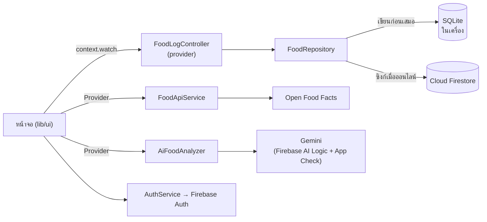

# Food Log — บันทึกอาหาร นับแคลอรี่ ด้วย AI

[](https://github.com/Petchkung/Food-Log/actions/workflows/ci.yml)

แอป Flutter สำหรับบันทึกอาหารและติดตามแคลอรี่รายวัน เพิ่มอาหารได้ 3 ทาง: **ถ่ายรูปให้ AI วิเคราะห์**, **ค้นจากฐานข้อมูลสินค้า Open Food Facts** และ **กรอกเอง** ข้อมูลเก็บในเครื่องก่อน (ใช้งานออฟไลน์ได้) แล้วซิงก์ขึ้น Cloud เมื่อออนไลน์

โครงงานวิชา Mobile Devices Software Development — KMITL

## ฟีเจอร์

| หน้า | ทำอะไรได้ |
|---|---|
| Welcome / เข้าสู่ระบบ | สมัคร/เข้าสู่ระบบด้วยอีเมล, ล็อกอินด้วย Google, ลืมรหัสผ่าน (ส่งอีเมลรีเซ็ต) |
| หน้าหลัก | วงแหวนแคลอรี่ "เหลืออีก ... kcal", แถบโปรตีน/คาร์บ/ไขมัน, การ์ด 4 มื้อ, เปลี่ยนวันย้อนหลัง, สถานะซิงก์ |
| บันทึก | ค้นหาอาหารจาก Open Food Facts, รายการล่าสุด, เลือกปริมาณ (กรัม) + มื้อ, สร้างอาหารเอง |
| สแกนด้วย AI | ถ่ายรูป / เลือกจากแกลเลอรี / บรรยายเป็นข้อความ → Gemini ประเมินแคลอรี่และสารอาหาร พร้อมความมั่นใจ, ปรับปริมาณ, แก้ไขเองได้ถ้า AI เดาผิด |
| สถิติ | กราฟแท่งแคลอรี่รายวัน (สัปดาห์/เดือน) พร้อมเส้นเป้าหมาย, ค่าเฉลี่ย, จำนวนวันที่เกินเป้า |
| โปรไฟล์ | ตั้งเป้าแคลอรี่ (800–6,000), ซิงก์ข้อมูล, ออกจากระบบ |

## ตรงกับเกณฑ์อย่างไร

| เกณฑ์ | สิ่งที่ทำ |
|---|---|
| 1. UI Material 3 + Usability Testing | Theme Material 3 (seed `#2F6B2F`), `NavigationBar`, `SearchBar`, `SegmentedButton`, `FilterChip`, ฯลฯ ออกแบบตาม Food Log UI + ทดสอบกับผู้ใช้ 5 คน |
| 2. Backend ≥ 2 บริการ | Firebase Authentication, Cloud Firestore, Open Food Facts REST API (+ Firebase AI Logic) |
| 3. AI | Gemini ผ่าน Firebase AI Logic วิเคราะห์รูป/ข้อความอาหาร → JSON → ตรวจและจำกัดค่าก่อนใช้ |
| 4. Local DB + Firestore | SQLite (sqflite) แบบ offline-first + ซิงก์กับ Firestore `users/{uid}/entries` |
| 5. Testing 4 ประเภท, coverage ≥ 70% | Unit, Widget, Integration, Security — 174 เทสต์, coverage ประมาณ 98% |
| 6. GitHub Actions | ทุก PR รัน analyze → test + coverage gate 70% → build APK |

## สถาปัตยกรรม



- **Offline-first:** บันทึกลง SQLite ก่อน แล้วค่อยส่งขึ้น Firestore รายการที่ส่งไม่สำเร็จถูกจดว่า `synced = false` และส่งใหม่ตอนกดซิงก์
- **ทุก service เป็น interface** (`AuthService`, `CloudSyncService`, `FoodApiService`, `AiFoodAnalyzer`, `PhotoPicker`) ตัวจริงใช้ตอนรันแอป ของปลอมใช้ในเทสต์ จึงทดสอบหน้าจอได้โดยไม่ต่อเน็ต

```
lib/
  app/        Theme, AuthGate, App Check
  core/       Validators, ตัวจัดรูปแบบภาษาไทย
  data/       LocalDatabase (SQLite), FoodRepository (offline-first + sync)
  models/     FoodEntry, MealType, DailySummary, NutritionInfo, StatsSummary
  services/   Auth, Firestore sync, Open Food Facts, Gemini, PhotoPicker
  state/      FoodLogController
  ui/         screens/ และ widgets/
test/         Unit + Widget + Security tests (helpers/ = ของปลอม)
integration_test/  เทสต์บนมือถือจริง + สคริปต์เติมข้อมูลเดโม
firestore.rules    กฎความปลอดภัยของ Firestore
```

## ความปลอดภัย

- **Firestore Security Rules:** อ่าน/เขียนได้เฉพาะข้อมูลของตัวเอง (`request.auth.uid == uid`) และตรวจรูปแบบข้อมูล (ฟิลด์ครบ, ชื่อ 1–80 ตัว, kcal 0–5,000, มื้อต้องเป็น 4 ค่าที่กำหนด)
- **SQLite:** ทุก query กรองด้วย `user_id` และใช้ parameter `?` (กัน SQL injection)
- **ข้อมูลจาก API/AI ไม่ถูกเชื่อตรง ๆ:** ลบ HTML ออกจากชื่อ, จำกัดตัวเลขไม่ติดลบและไม่เกินเพดาน
- **Prompt injection:** คำบรรยายของผู้ใช้ถูกห่อใน `<food>…</food>` และสั่ง AI ไม่ให้ทำตามคำสั่งในรูป/ข้อความ
- **App Check:** บังคับใช้กับ AI Logic — แอปที่ไม่ใช่ของเราเรียก Gemini ด้วยโควตาเราไม่ได้
- **Login:** ข้อความ error ไม่บอกว่าอีเมลมีบัญชีหรือไม่ (กันการเดาอีเมล), รหัสผ่านอย่างน้อย 8 ตัวมีทั้งตัวอักษรและตัวเลข

## เริ่มใช้งาน

**ต้องมี:** Flutter 3.44.x, Android Studio + emulator แบบ **Google Play** (เช่น Pixel 6 API 34 PlayStore)

```bash
git clone https://github.com/Petchkung/Food-Log.git
cd Food-Log
flutter pub get
flutter run
```

### ใช้ฟีเจอร์ AI ตอนพัฒนา

AI Logic บังคับ App Check ตอน debug ต้องใช้ debug token ที่ลงทะเบียนไว้ใน Firebase Console › App Check (ขอจากเจ้าของโปรเจกต์ทางแชตส่วนตัว **ห้าม commit token**):

```bash
flutter run --dart-define=APP_CHECK_DEBUG_TOKEN=<token>
```

ไม่ใส่ token แอปยังใช้ได้ทุกอย่าง ยกเว้นการเรียก AI

### ล็อกอินด้วย Google

ต้องเพิ่ม SHA-1 ของเครื่องที่ build ใน Firebase Console › Project settings › แอป Android:

```bash
keytool -list -v -keystore ~/.android/debug.keystore -alias androiddebugkey -storepass android -keypass android
```

## การทดสอบ

```bash
flutter analyze
flutter test --coverage            # Unit + Widget + Security
dart run tool/coverage.dart 70     # สรุป coverage และเช็กขั้นต่ำ 70%
flutter test integration_test/app_flow_test.dart   # ต้องเปิด emulator
```

| ประเภท | ตัวอย่าง |
|---|---|
| Unit | `test/models`, `test/data` (SQLite จริงผ่าน sqflite_common_ffi), `test/state`, `test/services` (Open Food Facts ผ่าน `MockClient`, แปลงคำตอบ AI) |
| Widget | `test/ui` ทุกหน้าจอ ใช้ Auth / Repository / API / AI / กล้องปลอม |
| Integration | `integration_test/app_flow_test.dart` — ล็อกอิน → เพิ่มอาหาร → ออฟไลน์แล้วซิงก์ → ลบ → ออก/เข้าใหม่ บนมือถือจริง |
| Security | แยกข้อมูลระหว่างผู้ใช้, SQL injection, encode พารามิเตอร์ URL, prompt injection, จำกัดขนาด/ชนิดรูป, ข้อความ error ไม่เปิดเผยบัญชี |

ไฟล์ที่คุยกับ Firebase โดยตรง (`firebase_*`, `firestore_sync_service.dart`, `gemini_food_analyzer.dart`, `app_check.dart`, `main.dart`) ไม่นับใน coverage เพราะทดสอบผ่าน interface + ของปลอมแทน

### เทสต์ที่เรียกบริการจริง (ไม่รันใน CI)

```bash
# เรียก Gemini จริง 1 ครั้ง
flutter test integration_test/ai_smoke_test.dart --dart-define=APP_CHECK_DEBUG_TOKEN=<token>

# เติมข้อมูลตัวอย่าง 14 วันให้บัญชีเดโม (รันซ้ำได้ — ลบข้อมูลเดโมเดิมก่อน)
flutter test integration_test/seed_demo_data_test.dart --dart-define=DEMO_PASSWORD=<รหัสผ่าน>
```

## CI/CD

`.github/workflows/ci.yml` รันทุก push และ Pull Request เข้า `main`:

1. `flutter analyze`
2. `flutter test --coverage`
3. `dart run tool/coverage.dart 70` — ต่ำกว่า 70% = ไม่ผ่าน
4. `flutter build apk --debug`

`main` ถูกป้องกันด้วย ruleset: ต้องผ่าน PR และ CI ต้องเขียวก่อน merge, ห้าม force push

## ทีม

| สมาชิก | งานหลัก |
|---|---|
| [Petchkung](https://github.com/Petchkung) | โครงแอป, Auth (อีเมล + Google + ลืมรหัสผ่าน), SQLite + Firestore + Security Rules, service Open Food Facts และ Gemini + App Check, เทสต์และ CI |
| [WisawaK](https://github.com/WisawaK) | หน้าจอตามดีไซน์: Welcome, เมนูล่าง, หน้าหลัก, สถิติ, โปรไฟล์ + Usability Testing |
| [sarasinee2005](https://github.com/sarasinee2005) | หน้าเพิ่มอาหาร (ค้นหา Open Food Facts, สร้างเอง), หน้าสแกนและหน้าผลวิเคราะห์ AI |

ทุกงานผ่าน branch `feature/*` + Pull Request ดูประวัติได้ที่ [Pull requests](https://github.com/Petchkung/Food-Log/pulls?q=is%3Apr)
